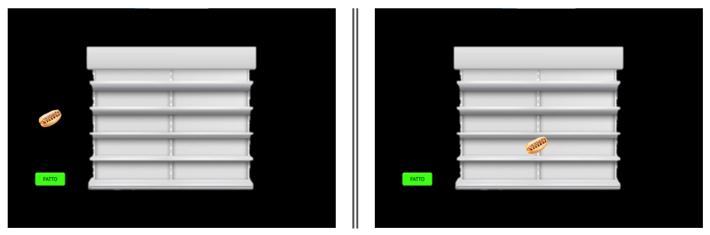
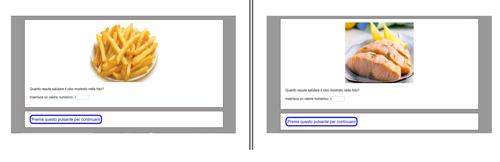
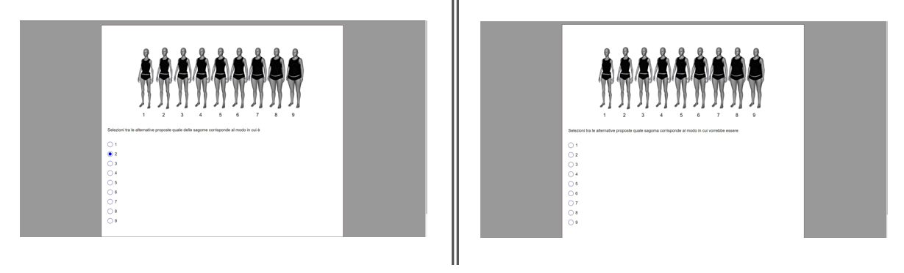

# [2022] Food Categorization and body image study 

This project integrates behavioral tasks with biometric and psychometric data.

**Research Objective:** exploring the "Healthy is Up" metaphor and how body perception influences the spatial categorization of food stimuli.

---

## Experimental Design and modules

The study is structured into two main technical modules implemented via **PsyToolkit**:

### 1. Assessment & Psychometrics (`assessment_and_surveys.psy`)
* **Biometrics & BMI:** automated collection of height and weight for real-time **Body Mass Index (BMI)** calculation.
* **Lifestyle Analytics:** scripted assessment of dietary habits (e.g., omnivorous, ketogenic, Mediterranean), food intolerances, and physical activity levels (amateur vs. competitive).
* **Body Dissatisfaction Scale (BDS):** implementation of the silhouette-based test (Mutale et al., 2016).
    * **Logic:** Participants select their "Real Self" vs. "Ideal Self" among 9 figures (ranging from extremely thin to extremely obese) to quantify body dissatisfaction.

### 2. Interactive "Scaffale" task and pst-task evaluation (`food_categorization_task.psy`)
* **Task mechanics:** a drag-and-drop paradigm where participants categorize 20 food stimuli (10 healthy, 10 unhealthy) onto a 5-shelf unit.
* **Stimuli management:** randomization of images selected from the **Food-475** and **Food101** databases, matched for shape and size.
* **Food preference and healthiness assessment:** following the shelf task, participants evaluated all 20 food stimuli using two 5-point Likert scales:
    * **Preference rating:** *"How much do you like the food shown in the photo?"* (1 = "Not at all" / 5 = "Very much").
    * **Healthiness rating:** *"How healthy do you consider the food shown in the photo?"* (1 = "Not at all healthy" / 5 = "Very healthy").
* **Logic:** Images (328x268px) were re-presented in a randomized order to eliminate order bias and analyze the consistency between behavioral categorization and explicit judgment.

---

## Visual implementation
The following images provide a preview of the experimental interface designed for this study:

### The "Scaffale" (Shelf) task

*Participants categorize food items by dragging them into the appropriate shelf level.*

### Food rating interface

*Evaluation interface for subjective food preference and healthiness ratings.*

### Body dissatisfaction silhouette test

*The 9-figure scale used to calculate the gap between perceived and ideal body image.*

---

## Technical logic
* **Modularity:** separate scripts for the survey and the interactive experiment to optimize data flow.
* **Data logging:** automated recording of selection accuracy, Reaction Times (RT), and qualitative ratings.
* **GDPR compliance:** full anonymization of participant data through custom-coded IDs.

---

## Data insights

### Interactive "Scaffale" (Shelf) task
* **Key Findings:**  Participants clearly differentiated stimuli categories (high main effect for healthiness).
    * Competitive athletes aligned perfectly with the "Healthy is Up" metaphor, positioning healthy foods significantly higher.
    * For athletes, a strong positive correlation was found between positioning healthy foods high and increased BMI.

### Body image and biometrics
* **BMI correlations:**  In sedentary subjects, increased BMI correlated significantly with higher body dissatisfaction.
    * Sedentary subjects displayed an inverse shelf positioning: as healthy foods went up, unhealthy foods went down.

##  Data logic
* **Data wrangling:** extensive use of Excel for raw data cleaning and BMI calculation.
* **Statistical modeling:** conducted via SPSS using ANOVA, MANOVA, and Pearson correlations to validate behavioral metaphors.
* **Assets:** stimuli matched for shape and size to eliminate visual bias during the shelf task.
---

## References
* **Mutale, C., et al. (2016).** Body Dissatisfaction Scale Assessment.
* **Bar, M. (2004).** Visual objects in context.
* **Stoet, G. (2010, 2017).** PsyToolkit software package.
---

